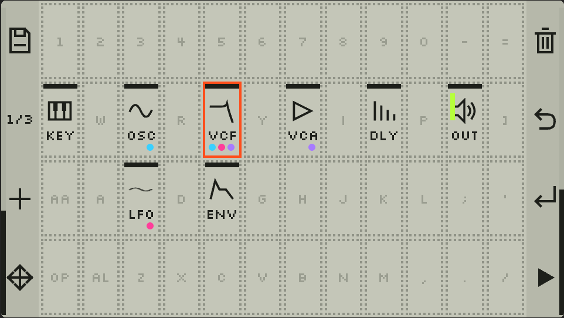

# Cardputer Modular

A mono modular synthesizer that runs on the **M5Stack Cardputer-Adv**. You build a patch on the
device itself: place modules on a 12×4 grid that matches the keyboard key for key, carry cables
between their pins, and tweak knobs. 68 module types (oscillators, a Plaits-based voice, filters,
envelopes, sequencers, a piano roll, drums, effects) and 50+ presets.

It was made to feed sounds into a Teenage Engineering **PO-33 K.O!** for sampling, so it goes for
range of sound over live playability.

## Please note

- **It's basically AI-generated.** The owner set the goals, made the design calls and tested on
  hardware; nearly all of the code and docs were written by Claude (Anthropic's AI model).
- **It's a proof of concept, not a productivity tool.** Expect rough edges and untested builds.
  Provided as is, with no guarantee of any kind (see [LICENSE](LICENSE)).

## More

The details (install, build, controls, module list, layout of the repo) are in
[docs/overview.md](docs/overview.md).

MIT licensed. Third-party parts: [THIRD_PARTY_NOTICES.md](THIRD_PARTY_NOTICES.md).
